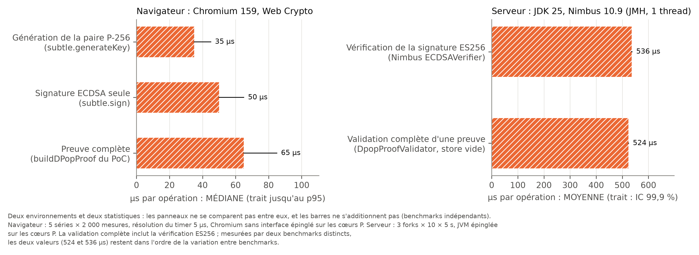
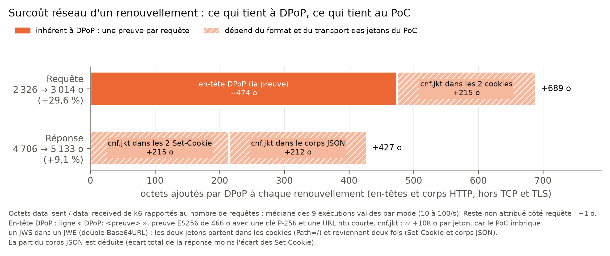
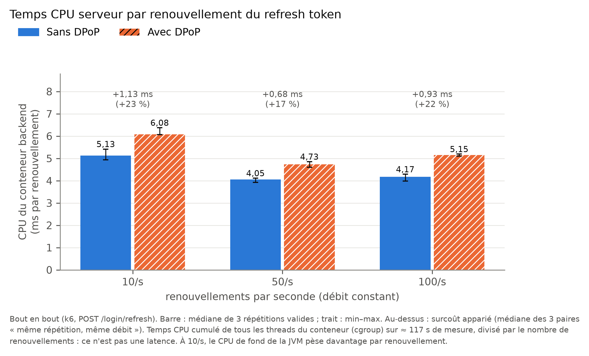
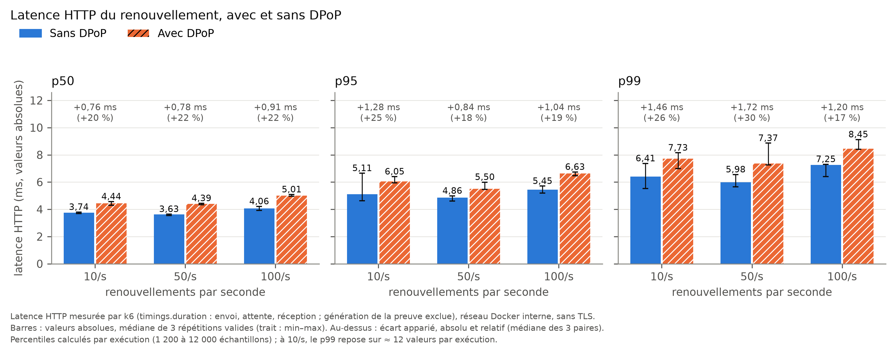
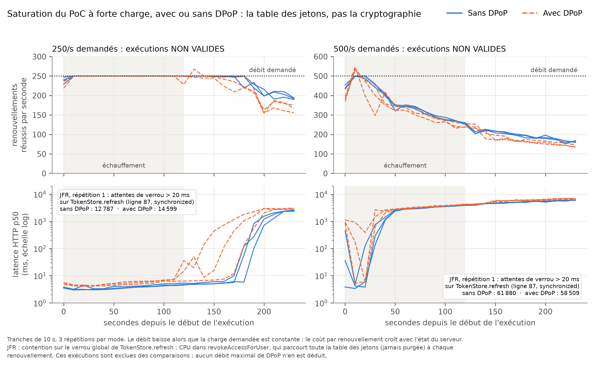
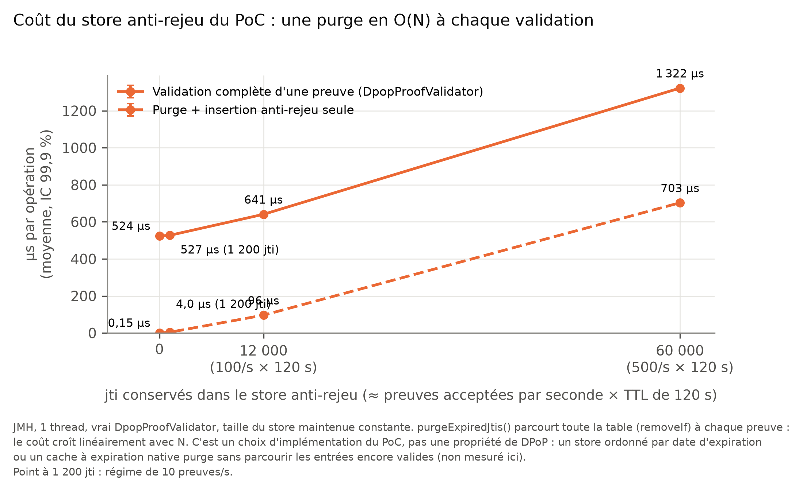

# Combien coûte DPoP ? Mesures sur le dpop-reader-kit

Benchmarks reproductibles du PoC de l'article MISC « DPoP en pratique : quand voler un jeton ne suffit plus ».

Campagne du 24-25 novembre 2026, révision `8e8ee37`, machine unique.

> **Traçabilité.** Tous les résultats de ce dossier ont été obtenus sur la révision `8e8ee37`. Le PoC rejette désormais les requêtes portant plusieurs en-têtes `DPoP` (RFC 9449 §4.3). Ce contrôle a été ajouté après la campagne de mesures. Son impact sur les performances n’a pas été mesuré. Voir [VALIDATION.md](VALIDATION.md) §7.

## 1. Objectif

Mesurer ce que DPoP (RFC 9449) ajoute au PoC, à trois niveaux, sans additionner leurs résultats :
- **dans le navigateur :** produire une preuve ;
- **sur le serveur :** valider une preuve ;
- **de bout en bout :** renouveler un refresh token avec et sans DPoP, à débit constant.

**Code mesuré :** uniquement le code de production du PoC :
- `frontend/src/dpopService.ts` ;
- `DpopProofValidator` ;
- l'image Docker du backend.

**Mode sans DPoP :** il réutilise le réglage existant `dpop.required=false`. Il n'est activable que dans un Compose de benchmark isolé, sur un réseau interne et sans port publié.

## 2. Principaux résultats

| Mesure | Sans DPoP | Avec DPoP | Écart |
|---|---:|---:|---:|
| Preuve dans Chromium (médiane) | – | 65 µs | – |
| Validation d'une preuve, serveur Java (moyenne, 1 thread) | – | 524 µs | – |
| Latence HTTP p50, 10 à 100 renouvellements/s | 3,63 à 4,06 ms | 4,39 à 5,01 ms | **+0,76 à +0,91 ms (+20 à +22 %)** |
| CPU serveur par renouvellement | 4,05 à 5,13 ms | 4,73 à 6,08 ms | **+0,68 à +1,13 ms (+17 à +23 %)** |
| Octets HTTP envoyés par renouvellement | 2 326 | 3 014 | +688 (+29,6 %), dont 474 pour l'en-tête DPoP |
| Octets HTTP reçus par renouvellement | 4 706 | 5 133 | +427 (+9,1 %), dus au format des jetons du PoC |

**Validité :** les 18 exécutions de 10 à 100/s sont valides, sans aucune erreur. Les 9 paires « même répétition, même débit » montrent toutes un surcoût positif en p50 et en CPU.

**Au-delà de 100/s :** à 250 et 500/s, **aucune exécution n'est valide, avec ou sans DPoP**. Le PoC sature sur sa table des jetons (§5). Aucun débit maximal n'est publié.

**Pile mesurée :** les chiffres serveur valent pour la pile Java du PoC (JDK 25, SunEC, Nimbus 10.9). Des mesures publiques sur d'autres piles donnent une vérification ES256 environ dix fois moins chère ([ANALYSIS.md](ANALYSIS.md) §2).

## 3. Surcoût cryptographique



**Côté navigateur**, en médiane sur 5 séries de 2 000 mesures :

| Opération | Médiane | Fréquence |
|---|---:|---|
| Génération de la paire ECDSA P-256 seule (`generateKey`) | 35 µs | une fois par session |
| Initialisation complète, `initializeDPopKeyPair()` : génération puis export de la JWK publique | 50 µs | une fois par session |
| Génération d'une preuve DPoP, `buildDPopProof()` (dont 50 µs de signature ECDSA ; p99 à 155 µs) | 65 µs | à chaque requête protégée |

Chaque ligne est une série mesurée séparément : les valeurs ne s'additionnent pas. La résolution du timer est de 5 µs.

**Côté serveur :**
- **Validation complète :** 524 µs avec un store anti-rejeu vide.
- **Vérification ES256 :** elle en représente l'essentiel.
- **Autres étapes :** parsing, clé, thumbprint, claims et contrôles coûtent chacune moins de 5 µs ([figure S1](results/summary/figures/figS1_etapes_validation.png)).

Les deux panneaux viennent d'environnements et de statistiques différents : ils ne se comparent pas et ne s'additionnent pas.

## 4. Surcoût réseau



**Inhérent à DPoP :** l'en-tête `DPoP` de chaque requête, soit 474 octets avec une clé P-256.

**Propre au PoC :** le reste, parce que `cnf.jkt` grossit des jetons que le PoC transporte plusieurs fois :
- chaque jeton est un JWS imbriqué dans un JWE (double Base64URL), d'où ≈ +107 octets par jeton ;
- les deux jetons partent dans les cookies à chaque renouvellement ;
- ils reviennent deux fois, dans les `Set-Cookie` et dans le corps JSON.

La RFC 9449 laisse le serveur libre de conserver la liaison du refresh token de son côté (§5), ce qui n'ajouterait rien au jeton.

## 5. Impact sur les performances applicatives





**Mesures :** le renouvellement du refresh token (`POST /login/refresh`) est mesuré à débit constant :
- 120 s d'échauffement, puis 120 s de mesure ;
- 3 répétitions dans un ordre aléatoire ;
- un conteneur neuf par exécution.

**Lecture des barres :** chaque barre est la médiane de 3 répétitions ; le trait va du minimum au maximum ; l'écart affiché au-dessus est la médiane des écarts appariés.

**CPU par renouvellement :** c'est le CPU cumulé du conteneur divisé par le nombre de renouvellements, pas une latence. À 10/s, le CPU de fond de la JVM pèse davantage. Une régression sur les trois débits donne +1,01 ms par renouvellement.

**À forte charge, le PoC sature, avec ou sans DPoP :**



- **Ce qu'on observe :** à charge constante, le débit baisse au fil de l'exécution.
- **La cause, selon JFR :** le verrou global de `TokenStore.refresh` et un parcours de toute la table des jetons, jamais purgée, à chaque renouvellement.
- **Ce que ça implique :** c'est une limite du PoC, pas de DPoP. Ces exécutions sont exclues des comparaisons.

## 6. Coût du mécanisme anti-rejeu



**Fonctionnement :** le PoC conserve chaque `jti` 120 s et purge tout le store à chaque preuve (`removeIf`). Le coût est donc linéaire en N.

**Validation complète selon la taille du store :**

| `jti` dans le store | 0 | 1 200 | 12 000 | 60 000 |
|---|---:|---:|---:|---:|
| Validation | 524 µs | 527 µs | 641 µs | 1 322 µs |

**Ce qui relève du PoC :** cette complexité vient de notre implémentation, pas de DPoP. Un store ordonné par date d'expiration, ou un cache à expiration native, purgerait sans parcourir les entrées encore valides (non mesuré ici).

**Ce que dit la RFC 9449 :** le suivi des `jti` y est facultatif (« can store », §11.1). Elle propose aussi le nonce serveur.

## 7. Limites et biais

Détail : [VALIDATION.md](VALIDATION.md) §5 et [METHODOLOGY.md](METHODOLOGY.md) §7.

**Environnement :**
- une seule machine, un portable à processeur hybride (Core Ultra 7 155H) ;
- pas de TLS, réseau Docker virtuel, une seule instance ;
- débits ≤ 100/s.

**Coûts propres à l'implémentation :**
- **Serveur :** le coût mesuré dépend de la pile Java ; il n'est pas propre à DPoP.
- **Micro et bout en bout :** l'écart entre JMH (+0,5 ms) et la mesure de bout en bout (+1 ms de CPU) n'est pas expliqué. Hypothèses : conteneurs non épinglés, GC, jetons plus longs.

**Variabilité :**
- **Répétitions :** 3 seulement, d'où des plages min–max et non des intervalles de confiance.
- **p95 et p99 à 10/s :** ils reposent sur peu d'échantillons.

**Navigateur :** un Chromium de bureau ; aucun mobile ni appareil d'entrée de gamme.

## 8. Mise en perspective

**État des connaissances :** aucune publication scientifique ni aucun benchmark contrôlé de bout en bout sur le coût de DPoP n'a été trouvé.

**Mesures publiques :** les mesures publiques disponibles (Node et jose, Go) placent la vérification ES256 vers 40 à 50 µs sur d'autres matériels. Ce n'est pas une comparaison directe.

**Choix de Google (octobre 2026) :**
- **Ce qui est lié :** Google lie avec DPoP **uniquement les refresh tokens**.
- **Les jetons d'accès :** ils restent des bearer d'une heure au plus.
- **La justification :** éviter « the per-request asymmetric cryptographic verification overhead of DPoP » sur ses API à fort trafic.

**Ce que montrent nos mesures :** le même mécanisme, à petite échelle. Le coût se paie à chaque requête protégée.

**Ce qu'elles ne montrent pas :** elles ne reproduisent pas les performances de Google.

Sources, analyse du compromis et conclusions : [ANALYSIS.md](ANALYSIS.md).

## 9. Reproduire

**Prérequis**, tous gratuits :

| Outil | Version de référence |
|---|---|
| JDK | 25 (`JAVA_HOME`) |
| Maven | 3.8+ |
| Node.js | 22.12+ |
| Docker | Desktop (WSL2) ou Engine |
| Python | 3.10+ avec `matplotlib` |
| Bash | sous Windows : Git Bash |

Playwright, Chromium et k6 v2.4.0 (dont la somme SHA-256 est vérifiée) sont téléchargés automatiquement.

**Lancer, depuis `dpop-reader-kit/benchmarks` :**

```bash
scripts/run_all.sh                 # campagne complète puis analyse : 4 h 40 ; refuse de démarrer sur batterie
scripts/run_browser.sh             # Web Crypto dans Chromium         (< 1 min)
scripts/run_jvm.sh                 # JMH, 3 forks × 10 × 5 s          (2 h 23)
scripts/run_load.sh                # k6, 5 débits × 2 modes × 3 rép.  (2 h 13)

python3 scripts/analyze.py         # synthèse CSV + RESULTS.md depuis les résultats bruts
python3 scripts/load_timeline.py   # chronologie des exécutions k6 (diagnostic de saturation)
scripts/jfr_hotspots.sh > results/summary/jfr_hotspots.txt   # contention et points chauds (JFR)
python3 scripts/figures.py         # figures SVG + PNG 300 dpi, depuis les seules synthèses versionnées
python3 scripts/verify_numbers.py  # contre-vérification des chiffres publiés depuis les données brutes
```

**Ce qui se rejoue depuis un simple clone du dépôt.** Les résultats bruts les plus volumineux (`k6.csv.gz`, `backend.jfr`) ne sont pas versionnés (voir §10).

| Script | Avec les seules données versionnées |
|---|---|
| `scripts/verify_numbers.py` | **oui** : recalcule les chiffres publiés depuis `raw.json`, `jmh.json.gz`, `measure_samples.csv.gz` et `run.json` |
| `scripts/figures.py` | **oui** : régénère les figures depuis `results/summary/` |
| `scripts/analyze.py` | **non** : la partie charge lit `k6.csv.gz` et s'arrête en son absence |
| `scripts/load_timeline.py` | **non** : il lit `k6.csv.gz`. Si un de ces fichiers manque ou est vide, il s'arrête avec un message explicite et le code de sortie 2, **sans modifier** `results/summary/load_timeline.csv` (chronologie versionnée qui alimente la figure 6) |
| `scripts/jfr_hotspots.sh` | **non** : il lit `backend.jfr` |

Ces trois derniers scripts se rejouent après une nouvelle campagne, qui produit les fichiers bruts complets.

**Essais rapides** (sans valeur de mesure) :

```bash
scripts/run_browser.sh --series 1 --iterations 200
scripts/run_jvm.sh -f 1 -wi 1 -w 2 -i 2 -r 2 DpopValidationBenchmark.fullValidation
CAMPAIGN=smoke RATES="50" REPS=1 WARMUP=10 DURATION=20 scripts/run_load.sh
```

**Points de méthode :**
- JMH et Chromium sont épinglés sur les cœurs P (`PIN_MASK`, `scripts/cpu_topology.ps1`).
- Une exécution k6 n'est valide que si elle respecte trois conditions :
  - erreurs ≤ 1 % ;
  - débit atteint ≥ 95 % du débit demandé ;
  - k6 sous 80 % de ses CPU.

## 10. Résultats bruts et rapports

| Document | Contenu |
|---|---|
| [results/summary/RESULTS.md](results/summary/RESULTS.md) | tous les tableaux générés : navigateur, JMH, charge, exécutions non valides |
| [results/summary/](results/summary/) | CSV de synthèse, `load_timeline.csv`, `jfr_hotspots.txt`, figures (SVG et PNG) |
| [METHODOLOGY.md](METHODOLOGY.md) | méthode détaillée, environnement, résultats commentés, diagnostic de saturation |
| [VALIDATION.md](VALIDATION.md) | contre-vérification interne des chiffres, biais et réserves, non-régression du PoC (tests, scénarios d'attaque, secrets), correction postérieure à la campagne |
| [ANALYSIS.md](ANALYSIS.md) | sources externes, choix de Google, conclusions |

**Organisation des résultats bruts :**

```
results/
  browser/<date>/   raw.json (tous les échantillons), meta.json, environment.json
  jvm/<date>/       jmh.json.gz (sortie JMH complète), jmh.log, environment.json
  load/<campagne>/  plan.csv, parameters.json, environment.json
    rep<N>/<débit>rps_<mode>/
      summary.json, run.json, docker_stats.csv, measure_samples.csv.gz
      k6.csv.gz, backend.jfr   bruts complets, volumineux, non versionnés
```

**Données sensibles :** aucun résultat ne contient de clé privée ni de jeton. Les clés de test sont générées en mémoire, et k6 n'exporte que des métriques.
